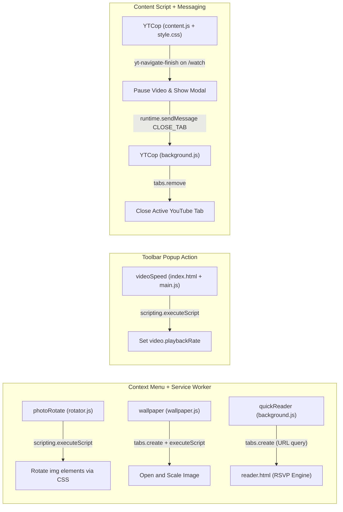

# Browser Extensions Collection


A curated collection of **5 lightweight, zero-dependency Manifest V3 browser extensions** for Chrome, Edge, Brave, and other Chromium-based browsers — covering speed reading, video playback speed control, image rotation, full-width wallpaper previews, and YouTube focus interventions.

---

## Extensions Overview

| Extension | Folder | Trigger / UI | Core Purpose |
| :--- | :--- | :--- | :--- |
| **photoRotate** | [`photoRotate/`](./photoRotate) | Right-click context menu | Rotate images on any webpage (`-90°`, `+90°`, `180°`, or reset `0°`) |
| **Quick Read** | [`quickReader/`](./quickReader) | Right-click on selected text → Dedicated tab | RSVP speed reader with ORP letter highlighting & punctuation micro-pauses |
| **video speed change** | [`videoSpeed/`](./videoSpeed) | Toolbar popup slider | Adjust HTML5 `<video>` playback speed from `0.25x` to `4.00x` (`0.25x` steps) |
| **wallpaper** | [`wallpaper/`](./wallpaper) | Right-click on image | Open an image directly in a new tab scaled to full viewport width |
| **YT Reality Check** | [`YTCop/`](./YTCop) | Automatic overlay on `youtube.com/watch` | Anti-procrastination modal that pauses YouTube videos and offers a 1-click tab close |

---

## Architecture Overview

All five extensions follow **Chrome Extension Manifest V3** with no bundler or external runtime dependencies, illustrating three core MV3 patterns:



---

## Extension Details

### 1. `photoRotate` — Webpage Image Rotator

Quickly reorient sideways or upside-down images directly inside the current tab without downloading them.

- **How It Works**: Registers a parent context menu (**`rotate photo`**) with four child actions in `rotator.js`. When triggered on an element with a `srcUrl`, it injects a CSS `transform: rotate(...)` rule onto `` elements in the active tab.
- **Controls (Right-Click Menu → `rotate photo`)**:
  - `rotate to left` — `-90deg`
  - `rotete to right` — `+90deg`
  - `turn Over` — `180deg`
  - `reset` — `0deg`
- **Entry Point**: `photoRotate/rotator.js` (Service Worker)
- **Permissions**: `scripting`, `contextMenus` · Host permissions: `https://*/*`, `http://*/*`

---

### 2. `quickReader` — RSVP Speed Reader ("Quick Read")

A distraction-free **Rapid Serial Visual Presentation (RSVP)** reader designed to help you read selected web text faster while maintaining eye fixation.

- **How It Works**: Highlight any text on a webpage, right-click, and choose **Quick Read**. `background.js` encodes the selection into a URL query parameter and opens `reader.html` in a new tab.
- **Key Features**:
  - **Optimal Recognition Point (ORP)**: Highlights the focal character of each word in red (`#ef4444`) aligned with top/bottom fixation markers.
  - **Punctuation Micro-Pauses**: Automatically extends display duration by `1.6x` on words ending in `.`, `,`, `!`, `?`, `;`, or `:` for natural comprehension.
  - **Dark Minimalist UI**: High-contrast monospace layout displaying live WPM (`300 WPM` default) and word progress (`index / total`).
- **Keyboard Shortcuts (inside Reader tab)**:
  | Key | Action |
  | :--- | :--- |
  | `Space` | Play / Pause (restarts from the beginning after finishing) |
  | `↑` (`ArrowUp`) | Increase reading speed by `+25 WPM` (up to `1000 WPM`) |
  | `↓` (`ArrowDown`) | Decrease reading speed by `-25 WPM` (down to `100 WPM`) |
  | `←` (`ArrowLeft`) | Rewind 10 words |
- **Files**: `background.js`, `reader.html`, `reader.js`, `main.css`
- **Permissions**: `contextMenus`, `tabs`

---

### 3. `videoSpeed` — HTML5 Video Playback Speed Controller

Override standard player speed caps on YouTube, lecture portals, and any site using HTML5 `<video>` elements.

- **How It Works**: Click the extension icon to open a dark-themed popup (`index.html`), drag the slider to pick a playback multiplier, and click **change speed**. `main.js` injects a script into the active tab that sets `playbackRate` on every `<video>` element.
- **Controls**:
  - **Range Slider**: `0.25x` to `4.00x` in `0.25x` increments (starts at `2.0x` with live `0.00x` preview).
  - **Apply Button**: Click **change speed** to apply immediately to all videos in the active tab.
- **Files**: `index.html`, `main.js`, `style.css`
- **Permissions**: `activeTab`, `scripting`

---

### 4. `wallpaper` — Full-Width Image Previewer

Inspect high-resolution images or wallpapers cleanly in a dedicated tab without page clutter.

- **How It Works**: Right-click any image (`contexts: ["image"]`) and select **`Otwórz jako tapete`** ("Open as wallpaper"). The service worker opens `info.srcUrl` in a new active tab and applies `width: 100%; height: auto` to the image for full-viewport viewing.
- **Entry Point**: `wallpaper/wallpaper.js` (Service Worker)
- **Permissions**: `activeTab`, `scripting`, `contextMenus`, `tabs` · Host permissions: `https://*/*`, `http://*/*`

---

### 5. `YTCop` — YT Reality Check (YouTube Focus Guard)

A lightweight mindfulness & anti-procrastination guard that interrupts mindless YouTube watching before a video plays.

- **How It Works**: Injects `content.js` and `style.css` on `*://*.youtube.com/*`. Listens for YouTube's native SPA navigation event (`yt-navigate-finish`): whenever you navigate to `/watch`, it pauses the `<video>` element and displays a blurred full-screen modal (**"Chwila prawdy"** / Moment of Truth). Navigating away removes the overlay automatically.
- **Modal Actions**:
  - **`Zmykam`** *(Leave)* — Sends `{ action: "CLOSE_TAB" }` to `background.js`, which immediately closes the YouTube tab.
  - **`Muszę to obejrzeć`** *(I must watch this)* — Dismisses the overlay so you can intentionally press play.
- **Files**: `content.js`, `style.css`, `background.js`
- **Permissions**: `tabs` · Content script match: `*://*.youtube.com/*`

---

## Project Structure

```text
browser-extentions/
├── photoRotate/        # Context-menu image rotator (manifest.json, rotator.js, images/)
├── quickReader/        # RSVP speed reader (manifest.json, background.js, reader.html, reader.js, main.css, images/)
├── videoSpeed/         # Popup video speed slider (manifest.json, index.html, main.js, style.css, images/)
├── wallpaper/          # Full-width image tab opener (manifest.json, wallpaper.js, images/)
└── YTCop/              # YouTube focus modal (manifest.json, content.js, style.css, background.js)
```

---

## Installation (Load Unpacked)

Because each extension is self-contained with zero build dependencies, you can load any (or all) of them directly in Chrome, Edge, or Brave:

1. **Clone the repository**:
   ```bash
   git clone https://github.com/Dudek03/browser-extentions.git
   ```
2. **Open the Extensions page** in your Chromium browser:
   - **Chrome**: `chrome://extensions`
   - **Edge**: `edge://extensions`
   - **Brave**: `brave://extensions`
3. **Enable Developer Mode** using the toggle in the top-right corner (or left sidebar in Edge).
4. Click **Load unpacked** and select one of the extension subdirectories (for example, `browser-extentions/quickReader` or `browser-extentions/YTCop`).
5. Repeat Step 4 for any additional extensions you want to install.

> [!TIP]
> Pin `videoSpeed` from the browser's extensions puzzle menu for instant one-click access to the playback speed slider.
